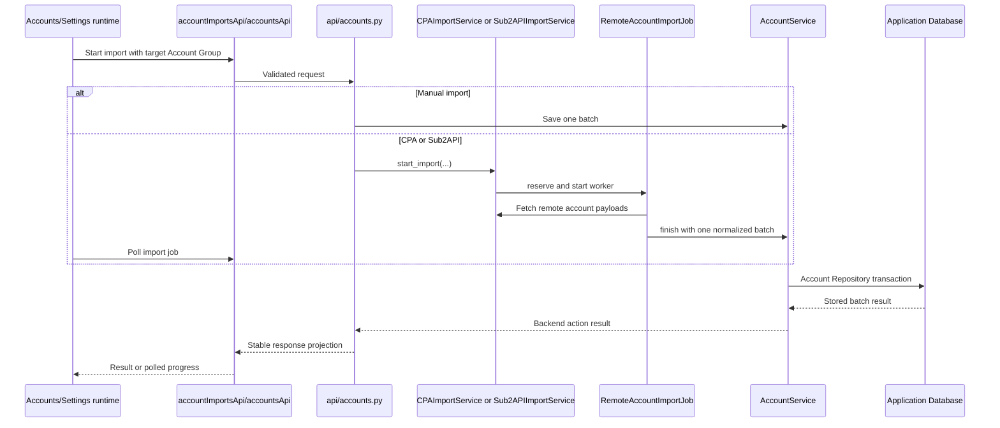
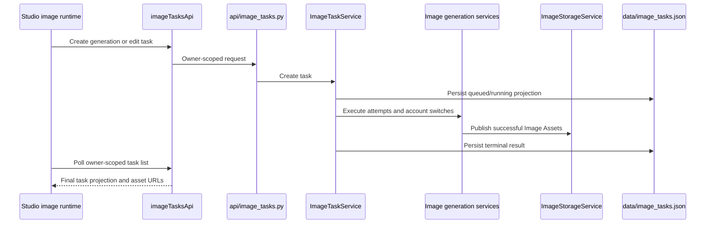
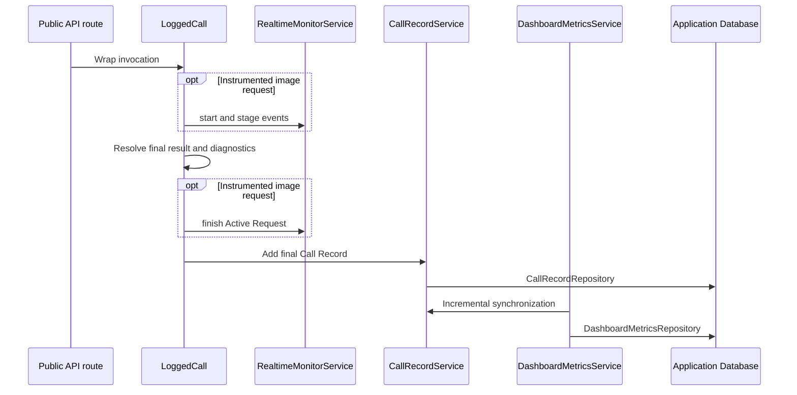
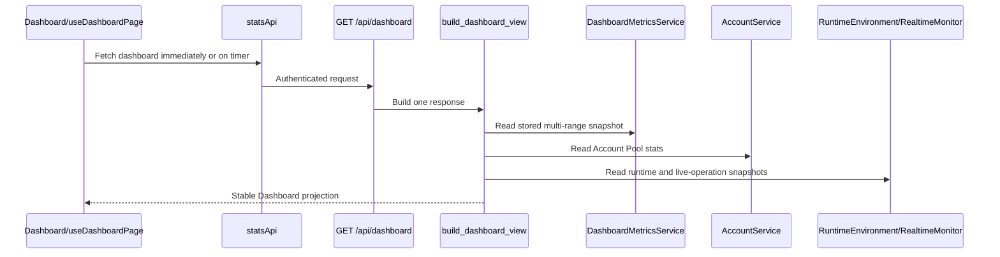
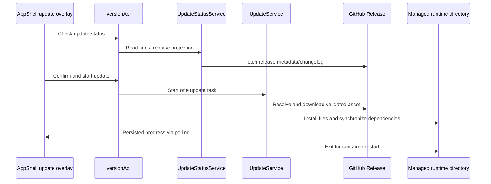

# Critical Flows

Status: current

These sequences identify the lifecycle owner and handoff points for workflows
that cross multiple Modules. They are navigation maps, not substitutes for
contracts or implementation.

## Account verification presentation

`services/account_view.py` derives one management category for account rows,
details, API filtering and selection previews. `AccountService.get_stats`
uses the same category for Dashboard counts and normal-account quota totals.
Remote check results `error` and `pending` project as `unverified` (`待验证`),
with disabled and confirmed-unusable accounts taking precedence. The console
renders a warning state, a matching filter and a separate Dashboard card.
This read-only projection does not persist a new account status or change
credential recovery, account removal or image selection policy.

## Account import

Manual JSON/credential import writes through the account API and
`AccountService`. CPA and Sub2API use one shared remote-job lifecycle.

`RemoteImportJobCoordinator` enforces the shared active-job rule. Both remote
sources finish through `RemoteAccountImportJob.finish`; source adapters do not
implement a second save lifecycle. The UI owns polling and presentation only.

## Studio Image Task

`ImageTaskService` owns task admission, transitions, attempts, resumption, and
terminal state. `ImageStorageService` exclusively owns Image Asset catalogue and
storage mutations. Studio owns browser conversation presentation and polling,
not task truth.

Image account admission retains its live remote authentication and quota preflight.
For five minutes after a successful full check, image admission reuses known
identity and plan metadata and still calls conversation/init for current auth
and quota. Missing metadata, expired or future timestamps, credential changes,
or a failed remote check require the full three-request check. AccountService
owns `last_full_remote_checked_at`; quota-only checks never advance it. Existing
records without this field use their last successful check, which predates scoped
checks and was full. Explicit synchronization always performs the full check.
Successful image preflight fallback to direct is handed from AccountService to
the image lifecycle as request-local context. It is stripped before account
persistence and discarded for rejected candidates; later requests select egress
again. Timeline segments separate preflight retry from the inclusive raw account
time and record pre-submission connection retry independently.
Preflight reads use a two-second connection timeout and a twenty-second
read budget. Sentinel preparation logs separate prepare/finalize HTTP wait from
local proof computation; tokens and challenges are never shared across calls.
Fast image delivery caps its first result-poll wait at half a second;
confirmation/settle modes retain their configured delays. Read-only conversation
polling honors transient 429 Retry-After without resubmitting generation.
Result polling reads the conversation first and skips task diagnostics when
output IDs are already present. While pending, task checks run at most once per
five seconds; fast mode waits one second after the first miss, then at most two
seconds between probes (or a smaller configured interval). Explicit confirmation
and settle behavior retains its configured delays. Conversation and task HTTP
timeouts are bounded by the remaining poll budget. The request timeline labels
SSE as the upstream conversation response, classifies pending-result waits and
remote result queries under upstream generation/readiness, and displays download
URL resolution separately. A completed SSE response does not prove the image is
ready; historical timing values are not changed by the new projection.
When a fallback egress is configured, `ProxySettingsStore` resolves an unavailable
proxy group through that fallback once. `OpenAIBackendAPI.get_user_info` retries
read-only preflight transport failures once through a distinct fallback profile;
authentication, HTTP, and quota rejections retain their existing handling. Neither
path changes the account's stored proxy assignment. The image backend marks a
generation POST as submitted before transport, retaining that guard for ambiguous
timeouts; only curl DNS, connect, and TLS-handshake failures clear it. The image
orchestrator permits egress fallback and cross-account transport retry only before
submission. Explicit 401/403/429 rejection clears the submission guard to retain
the existing authentication/quota recovery policy; it does not trigger egress
fallback. An unavailable fallback group raises rather than recursively resolving.
Within eligible accounts with spare image capacity, candidates without a remote
preflight error are tried first. Error candidates remain available when that
preferred set is empty; this scheduling preference neither disables accounts
nor changes their proxy bindings or quota state.

Credential format validation rejects non-ASCII characters, controls and internal
spaces before transport creation. Invalid ATs with usable RTs remain recoverable;
without an RT they are unavailable. Account rows, status filters and dashboard
counts use the same effective status category, without rewriting stored status.
An unknown plan or a network check failure alone does not invalidate credentials.

Each ChatGPT Web image slot downloads and publishes at most one upstream
candidate. Normal completion and interrupted-stream recovery share this limit,
so extra variants do not multiply the requested count or response usage.

## Call Record, live monitor, and metrics

The Call Record is durable final truth. Active Requests and live operations are
process-memory observations and may disappear on restart. The Dashboard Metric
Projection reads only Call Records after its stored sequence during normal
synchronization, updates affected hourly rows atomically, and rebuilds only when
an explicit repository operation rotates the Call Record generation or an
aggregate table is structurally incompatible. User-facing log deletion and
automatic retention preserve the cursor, so the 30-day history remains
independent of the shorter Call Record retention window. If only the projection
state table is recreated, startup checkpoints the current cursor without
deleting compatible hourly aggregates.

## Dashboard projection

The backend owns metric definitions, available ranges, units, health, and
runtime values. Account cards and Active Request counts read current state;
24-hour call cards and all chart ranges come from the same 30-day hourly
projection; runtime-environment samples are not persisted. The page selects one
returned range and owns refresh timing, retained snapshots, chart construction,
animation, layout, and responsive behavior.

## Managed-container online update

`UpdateService` owns the complete update task and rejects unsupported runtime
modes. The frontend only confirms, starts, polls, and renders progress. Update
task state is persisted in `data/update_task.json`; the container runtime owns
restarting the process after exit.
